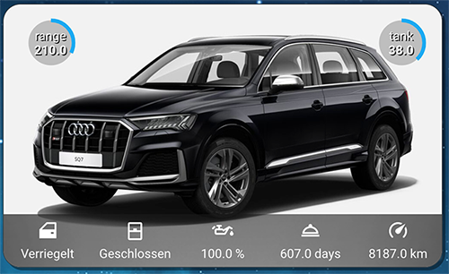

# Audi Connect Integration for Home Assistant

[![GitHub Activity][commits-shield]][commits]
[![License][license-shield]](LICENSE.md)
[![Code Style][blackbadge]][black]
[![hacs][hacsbadge]](hacs)

## Notices

> [!Important]
> **Authentication status.** Audi's legacy device and refresh flows are blocked in affected regions. The integration now uses the interactive myAudi Auth0/PKCE flow there. Existing entries that fail with `invalid assertion headers` will request reauthentication. See [#903](https://github.com/audiconnect/audi_connect_ha/issues/903) for background.

Due to API changes, **currently not all functionality is available**. Please open a issue to report the topics you are missing.

> [!Caution]
> Excessive use of certain features in this integration may result in temporary or permanent suspension of your Audi Connect account. Please use responsibly — abuse or misuse could potentially impact access for the entire community. Use at your own risk.

## Maintainers Wanted

- Looking for maintainers for Translation documents.
- Always looking for more help from the community. If you can resolve an issue, please submit a PR or reach out to the maintainers with the working code.

## Description

The `audiconnect` component provides an integration with the Audi Connect cloud service. It adds presence detection, sensors such as range, mileage, and fuel level, and provides car actions such as locking/unlocking and setting the pre-heater.

**Note:** Certain functions require special permissions from Audi, such as position update via GPS.

Credit for initial API discovery go to the guys at the ioBroker VW-Connect forum, who were able to figure out how the API and the PIN hashing works. Also some implementation credit to davidgiga1993 of the original [AudiAPI](https://github.com/davidgiga1993/AudiAPI) Python package, on which some of this code is loosely based.

Full credit for this integration goes to @arjenvrh for their outstanding work in putting it all together. We wouldn’t have this without their contributions.

## Installation

There are two ways this integration can be installed into [Home Assistant](https://www.home-assistant.io).

The easiest and recommended way is to install the integration using [HACS](https://hacs.xyz), which makes future updates easy to track and install.

Alternatively, installation can be done manually by copying the files in this repository into the `custom_components` directory in the Home Assistant configuration directory:

1. Open the configuration directory of your Home Assistant installation.
2. If you do not have a `custom_components` directory, create it.
3. In the `custom_components` directory, create a new directory called `audiconnect`.
4. Copy all files from the `custom_components/audiconnect/` directory in this repository into the `audiconnect` directory.
5. Restart Home Assistant.
6. Add the integration to Home Assistant (see **Configuration**).

## Configuration

Configuration is done through the Home Assistant UI.

To add the integration, go to **Settings ➤ Devices & Services ➤ Integrations**, click **➕ Add Integration**, and search for "Audi Connect".

For Auth0 regions, Home Assistant displays an Audi login link. Open it in a private browser window and sign in. Audi redirects to its registered `http://localhost:8080/myaudi-callback` URL; an unable-to-connect page is expected because no local server is required. Copy the complete URL from the browser address bar and paste it into the Home Assistant form. Home Assistant validates the OAuth state and exchanges the one-time code using PKCE.

### Configuration Variables

| Name            | Type     | Default | Description                                                                                                                                                                                                                          |
| --------------- | -------- | ------- | ------------------------------------------------------------------------------------------------------------------------------------------------------------------------------------------------------------------------------------ |
| `Username`      | `string` | –       | The username associated with your Audi Connect account. Used only in regions that retain password login.                                                                                                                             |
| `Password`      | `string` | –       | The password for your Audi Connect account. Used only in regions that retain password login.                                                                                                                                         |
| `S-PIN`         | `string` | –       | The S-PIN for your Audi Connect account to perform certain service actions.<br>(**Optional**)                                                                                                                                        |
| `Region`        | `string` | `DE`    | The region where your Audi Connect account is registered:<br>• `DE` – Europe<br>• `US` – United States<br>• `CA` – Canada<br>• `CN` – China                                                                                          |
| `Scan Interval` | `int`    | `15`    | Frequency (in minutes) to fetch status data from Audi Connect.<br>Minimum allowed is 15 minutes.<br>\* _Can be updated later via the CONFIGURE menu._                                                                                |
| `API Level`     | `int`    | `0`     | Determines the API structure used for service action calls:<br>• `0` – _Typically_ Gas vehicles (legacy format)<br>• `1` – _Typically_ e-tron (electric vehicles, newer format)<br>\* _Can be updated later via the CONFIGURE menu._ |

## Options

Find configuration options under **Settings ➤ Devices & Services ➤ Integrations ➤ Audi Connect ➤ Configure**:

| Name                                | Type   | Default | Description                                                                                                                                                                                                                                                                                                         |
| ----------------------------------- | ------ | ------- | ------------------------------------------------------------------------------------------------------------------------------------------------------------------------------------------------------------------------------------------------------------------------------------------------------------------- |
| `Cloud Update at Startup`           | `bool` | `True`  | Toggle the initial cloud update when the integration starts. Useful for development or frequent Home Assistant restarts.                                                                                                                                                                                            |
| `Refresh Vehicle Data After Action` | `bool` | `False` | Send a vehicle refresh command after every service action (e.g. climate, lock). This is typically not required as the vehicle will check in with the cloud on its own after a command. Each vehicle refresh counts against the API rate limit. To improve responsiveness, increase the Cloud Refresh Delay instead. |
| `Cloud Refresh Delay`               | `int`  | `5`     | Seconds to wait after a service action before refreshing cloud data. A longer delay gives the vehicle more time to report its updated state to the cloud.                                                                                                                                                           |
| `Scan Interval`                     | `int`  | `15`    | Defines polling frequency in minutes (minimum 15).                                                                                                                                                                                                                                                                  |
| `Excluded VINs`                     | `str`  | –       | Comma-separated VIN list to exclude from setup and updates.                                                                                                                                                                                                                                                         |

_Note: The integration will reload automatically upon clicking `Submit`, but a Home Assistant restart is suggested._

## Controls

Each vehicle's device page exposes its actions directly, so the common ones no longer need a service call. Availability depends on what the vehicle reports and, for the lock and engine controls, on an S-PIN being configured.

| Control                        | Type    | Replaces                                              |
| ------------------------------ | ------- | ----------------------------------------------------- |
| `Door lock`                    | Lock    | `execute_vehicle_action` with `lock` / `unlock`       |
| `Climatisation`                | Climate | `start_climate_control` / `stop_climatisation`        |
| `Preheater`                    | Switch  | `execute_vehicle_action` with `start_/stop_preheater` |
| `Global charge target`         | Number  | `set_target_soc`                                      |
| `Current location target`      | Number  | `set_location_charge_target` (no `profile_id`)        |
| `<Profile> charge target`      | Number  | `set_location_charge_target` with `profile_id`        |
| `Start engine` / `Stop engine` | Button  | `start_engine` / `stop_engine`                        |
| `Flash lights`                 | Button  | n/a, new                                              |
| `Charge mode`                  | Select  | `set_charge_mode`                                     |
| `Refresh vehicle data`         | Button  | `refresh_vehicle_data`                                |

### Feature status and API compatibility

Audi vehicles and regions do not all expose the same features. The integration
distinguishes between an Audi API request being accepted and the vehicle
actually performing an action. Check the vehicle and its subsequent reported
state before relying on remote commands in automations.

| Status                               | Control or capability                                               | Notes                                                                                                                                   |
| ------------------------------------ | ------------------------------------------------------------------- | --------------------------------------------------------------------------------------------------------------------------------------- |
| Standard, capability-dependent       | Door lock/unlock and flash lights                                   | Require the corresponding vehicle permission; verify the actual vehicle state                                                           |
| Standard on supported Auth0 vehicles | **Climatisation ON/OFF** switch                                     | Uses the climate settings already stored in the car and reads the car's reported state; does not replace the climate temperature entity |
| Legacy / model-dependent             | **Preheater** and the original **Climatisation** climate entity     | Retained for compatibility; older routes may be unavailable or rejected on newer Auth0-backed accounts                                  |
| Experimental, opt-in                 | Charging start/stop, window heating start/stop, manual vehicle wake | Disabled by default; enable _experimental vehicle controls_ under Configure, where a reported capability permits the action             |
| Model-dependent                      | Charge mode and target SOC changes                                  | Audi may accept an HTTP request while rejecting or not applying the setting                                                             |

_Legacy_ describes an older interface; it does not announce removal.
The integration keeps existing unique IDs and service calls where possible.
Availability and feature support must be checked per vehicle, not inferred from
one successful command or a capability list alone. A partial cloud response
may leave an entity **unavailable** instead of removing it.

**Lock/unlock:** Both directions now use one post-command refresh and
expose a `last_command_status` attribute: `request_failed`,
`accepted_unconfirmed`, `confirmed_by_readback`, or
`already_reported_in_requested_state`. An Audi gateway acknowledgement or
a delayed cloud state is not a confirmed physical door action, and neither
direction issues a blind retry.

**Remote engine:** Older non-Auth0 combustion vehicles without a capability
inventory retain the previous engine-button fallback. Explicit capability
denial, impaired support, known hybrid/electric types, and Q8 model vetoes
still apply. Auth0 vehicles require an explicitly reported permission.

**Charging settings:** On Auth0 vehicles a global target-SOC update refuses
to submit a potentially destructive `charging/settings` PUT if Audi returns
unknown settings. Known writable settings are preserved; timestamp metadata
is excluded. Additional writable keys require vehicle-specific evidence.

**Q8 climate:** On the tested Audi Q8 PHEV, climate ON/OFF works through the
separate modern Auth0/CARIAD command path using the car's stored settings.
Passing a temperature to the legacy climate interface has not worked on that
vehicle. This does not establish support across other Audi types or regions.
A future capability model should combine reported features with vehicle type,
API generation and verified model-specific behavior, without assuming that a
model name grants permission or that a missing capability is definitive proof
of absence.

Optional local dealer/service details, where configured, are kept in Home
Assistant options; they are **not** retrieved from Audi's cloud and must not be
confused with manufacturer-provided service data.

### Charge targets

There are three kinds, because the car has three places to put the number:

- **Global charge target** writes `charging/settings`. It does not govern where a charge stops at a location (upstream #722), so it is the least useful of the three and is kept only because it is a real, separately-stored setting.
- **Current location charge target** writes whichever profile the car is parked in, resolved by the integration from `vehiclePositionedInProfileID`. Use it in automations that should apply wherever the car happens to be.
- **One number per location profile**, named after the profile ("Home charge target", "Work charge target"). These are enumerated from what the car reports, so a profile added or removed in the car appears or disappears after the next refresh. A profile deleted in the car leaves its control unavailable rather than showing a stale target.

`sensor.<vehicle>_active_charging_profile_name` says which profile is in force, so a dashboard can show the governing location beside the sliders. The per-profile controls are keyed on the profile id, not its name, so renaming a location in the myAudi app renames the control without breaking automations that reference it.

The service actions below still work and remain the way to reach the parameterised commands: `start_climate_control` (temperature, seat and glass heating, climatisation mode) and `start_auxiliary_heating` (duration) both take settings the vehicle does not report back, so they have no on-page control.

### Starting and stopping a charge

Neither is exposed by default, because neither has been consistently verified. Optional experimental start/stop charging controls are available only with an explicit opt-in and a reported vehicle capability; they may still be rejected or have no physical effect.

Stopping is accepted by the API and confirmed by the car, and the charge continues. Sent twice from a settled state on a live vehicle, which carried on drawing 6.5 kW both times.

Starting is unproven. It appeared to work once, but the car had a target well above its state of charge at that moment and would have charged anyway; repeated later with the target below the state of charge, the command was accepted and nothing happened. There is no evidence separating "the button started the charge" from "the car was going to charge regardless".

Timed charging is not exposed either, for the same reason: it goes through the same command as start and stop.

Use `Target state of charge` instead. Raising it above the current level starts a charge and lowering it below stops one, which is the lever that behaved consistently in every direction under testing. The car's departure timers are the other reliable route, and are reported here but not yet writable.

## Climatisation

The climate entity turns climatisation on and off and sets the target temperature. The car reports whether climatisation is running and in which mode (heating, cooling, ventilation), so the entity reflects the vehicle rather than what Home Assistant last asked for.

Two things it deliberately does not do. It has no current temperature, because the car reports the outdoor reading and not the cabin, and showing the outside temperature as a climate entity's current temperature would misstate what it measures. And it does not expose seat or glass heating, climatisation-at-unlock, or the comfort/economy mode: the vehicle never reports those back, so a control for them would only ever show what you last set. Use the `start_climate_control` service action for those.

The target temperature comes from the car, which reports it in its climatisation settings. Home Assistant only holds a value as a fallback for a vehicle that reports none, and for the moment between asking for a change and the car confirming it. Note the car stores half degrees while the write truncates to whole ones, so a target set outside Home Assistant can read as 15.5 even though the control steps in whole degrees.

The rest of the climatisation settings the car reports (window heating, climatisation at unlock, and the seat zones it has) appear as switches under configuration. They are written through the car's settings endpoint without starting climatisation, which the myAudi app does not offer: there, a heated seat can only be enabled while starting the air conditioning.

Each toggle sends the whole settings object back with one field changed, because the endpoint replaces rather than merges. Changing a seat therefore cannot clear the target temperature.

`start_auxiliary_heating` (duration) stays service-only for the same reason.

## Why an entity sometimes disappears

Entities are created when the integration sets up, and until now that decision asked whether the value was present in the poll it happened to be holding. A partial or rate-limited poll therefore removed controls: on one vehicle a `429 Too Many Requests` took sixteen entities away, including a parking-position sensor for a car that plainly has parking position. They returned only after a reload.

The car reports what it can do, separately from what any one poll contains, and the integration now asks that list instead where a capability maps cleanly onto an entity. A missing value leaves the entity unavailable rather than deleting it.

Vehicles that do not report a capability list are unaffected and keep the previous behaviour.

### Flash lights

Flashes the vehicle's lights for ten seconds. The car must have reported a position, because the API requires one; the control refuses rather than sending a request that would be rejected.

The horn is not exposed. The endpoint that flashes the lights also sounds them together, one string apart, and the integration sends only the flash mode with no way for a caller to reach the other.

## Service Actions

### Audi Connect: Refresh Vehicle Data

`audiconnect.refresh_vehicle_data`

Normal updates retrieve data from the Audi Connect cloud service, and don't interact directly with the vehicle. _This_ service action triggers an update request from the vehicle itself. When data is retrieved successfully, Home Assistant is automatically updated. The service action requires a vehicle identification number (VIN) as a parameter.

#### Parameters

- **`vehicle`**: The Audi vehicle to perform the action on.

> [!CAUTION]
> **This service action counts against your daily API rate limit.** Repeated use may exhaust your limit. Use sparingly and monitor your remaining API calls via the **"API Requests Remaining"** diagnostic sensor or **Settings → System → Repairs & System Information**.

> [!NOTE]
> The **"API Requests Remaining"** diagnostic sensor restores its last known value after a Home Assistant restart. Its `last_observed` attribute records when Audi last returned a `Vcf-Remaining-Calls` value. If `value_restored` is `true`, the displayed value was restored from the previous Home Assistant runtime and may no longer represent the current remaining allowance.

### Audi Connect: Refresh Cloud Data

`audiconnect.refresh_cloud_data`

_This_ service action triggers an update request from the cloud.

- Functionality: Updates data for all vehicles from the online source, mirroring the action performed at integration startup or during scheduled refresh intervals.
- Behavior: Does not force a vehicle-side data refresh. Consequently, if vehicles haven't recently pushed updates, retrieved data might be outdated.
- Note: This service action replicates the function of active polling without scheduling, offering a more granular control over data refresh moments.
- **IMPORTANT:** This service action has no built in usage limits. Excessive use may result in a temporary suspension of your account.

#### Parameters

- `none`

### Audi Connect: Execute Vehicle Action

`audiconnect.execute_vehicle_action`

This service action allows you to perform actions on your Audi vehicle, specified by the vehicle identification number (VIN) and the desired action.

#### Service Parameters

- **`vehicle`**: The Audi vehicle to perform the action on.
- **`action`**: The specific action to perform on the vehicle. Available actions include:
  - **`lock`**: Lock the vehicle.
  - **`unlock`**: Unlock the vehicle.
  - **`start_climatisation`**: Start the vehicle's climatisation system. (Legacy) -- Deprecated
  - **`stop_climatisation`**: Stop the vehicle's climatisation system.
  - **`start_charger`**: Start charging the vehicle.
  - **`start_timed_charger`**: Start the vehicle's charger with a timer.
  - **`stop_charger`**: Stop charging the vehicle.
  - **`start_preheater`**: Start the vehicle's preheater system. (Legacy) -- Deprecated
  - **`stop_preheater`**: Stop the vehicle's preheater system.
  - **`start_window_heating`**: Start heating the vehicle's windows.
  - **`stop_window_heating`**: Stop heating the vehicle's windows.

#### Usage Example

To initiate the lock action for a vehicle with VIN `WAUZZZ4G7EN123456`, use the following service call:

```yaml
service: audiconnect.execute_vehicle_action
data:
  device_id: 034986de941a1f824b3f06c0a1d9333f
  action: "lock"
```

#### Notes

- Certain service actions require the S-PIN to be set in the configuration.
- After a successful action, the integration waits for the configured **Cloud Refresh Delay** and then performs a cloud data refresh. If **Refresh Vehicle Data After Action** is enabled, a vehicle refresh is also sent before the delay.

### Audi Connect: Start Climate Control

`audiconnect.start_climate_control`

This service action allows you to start the climate control with options for temperature, glass surface heating, and auto seat comfort.

#### Parameters

- **`vehicle`**: The Audi vehicle to perform the action on.
- **`temp_f`** (_optional_): Desired temperature in Fahrenheit. Default is `70`.
- **`temp_c`** (_optional_): Desired temperature in Celsius. Default is `21`.
- **`glass_heating`** (_optional_): Enable (`True`) or disable (`False`) glass heating. Default is `False`.
- **`seat_fl`** (_optional_): Enable (`True`) or disable (`False`) the front-left seat heater. Default is `False`.
- **`seat_fr`** (_optional_): Enable (`True`) or disable (`False`) the front-right seat heater. Default is `False`.
- **`seat_rl`** (_optional_): Enable (`True`) or disable (`False`) the rear-left seat heater. Default is `False`.
- **`seat_rr`** (_optional_): Enable (`True`) or disable (`False`) the rear-right seat heater. Default is `False`.

#### Usage Example

To start the climate control for a vehicle with VIN `WAUZZZ4G7EN123456` with a temperature of 72°F, enable glass heating, and activate both front seat heaters, use the following service call:

```yaml
service: audiconnect.start_climate_control
data:
  device_id: 034986de941a1f824b3f06c0a1d9333f
  temp_f: 72
  glass_heating: True
  seat_fl: True
  seat_fr: True
```

#### Notes

- The `temp_f` and `temp_c` parameters are mutually exclusive. If both are provided, `temp_f` takes precedence.
- If neither `temp_f` nor `temp_c` is provided, the system defaults to 70°F or 21°C.
- After a successful action, the integration waits for the configured **Cloud Refresh Delay** and then performs a cloud data refresh. If **Refresh Vehicle Data After Action** is enabled, a vehicle refresh is also sent before the delay.

### Audi Connect: Start Auxiliary Heating

`audiconnect.start_auxiliary_heating`

This service action allows you to start auxiliary heating the vehicle, with option for duration.

#### Parameters

- **`vehicle`**: The Audi vehicle to perform the action on.
- **`duration`** (_optional_): The number of minutes the auxiliary heater should run before turning off. Default is `20` minutes if not provided.

#### Usage Example

To start the auxiliary heater for a vehicle with VIN `WAUZZZ4G7EN123456`, and a duration of 40 minutes, use the following service call action:

```yaml
service: audiconnect.start_auxiliary_heating
data:
  device_id: 034986de941a1f824b3f06c0a1d9333f
  duration: 40
```

#### Notes

- Requires the S-PIN to be set in the configuration.
- After a successful action, the integration waits for the configured **Cloud Refresh Delay** and then performs a cloud data refresh. If **Refresh Vehicle Data After Action** is enabled, a vehicle refresh is also sent before the delay.

## Example Dashboard Card

Below is an example Dashboard (Lovelace) card illustrating some of the sensors this Home Assistant addon provides.



The card requires the following front end mods:

- https://github.com/thomasloven/lovelace-card-mod
- https://github.com/custom-cards/circle-sensor-card

These mods can (like this integration) be installed using HACS.

The card uses the following code in `ui-lovelace.yaml` (or wherever your Dashboard is configured).

```yaml
     - type: picture-elements
        image: /local/pictures/audi_sq7.jpeg
        style: |
          ha-card {
            border-radius: 10px;
            border: solid 1px rgba(100,100,100,0.3);
            box-shadow: 3px 3px rgba(0,0,0,0.4);
            overflow: hidden;
          }
        elements:
        - type: image
          image: /local/pictures/cardbackK.png
          style:
            left: 50%
            top: 90%
            width: 100%
            height: 60px

        - type: icon
          icon: mdi:car-door
          entity: sensor.doors_trunk_sq7
          tap_action: more_info
          style: {color: white, left: 10%, top: 86%}
        - type: state-label
          entity: sensor.doors_trunk_sq7
          style: {color: white, left: 10%, top: 95%}

        - type: state-icon
          entity: sensor.windows_sq7
          tap_action: more_info
          style: {color: white, left: 30%, top: 86%}
        - type: state-label
          entity: sensor.windows_sq7
          style: {color: white, left: 30%, top: 95%}

        - type: icon
          icon: mdi:oil
          entity: sensor.audi_sq7_oil_level
          tap_action: more_info
          style: {color: white, left: 50%, top: 86%}
        - type: state-label
          entity: sensor.audi_sq7_oil_level
          style: {color: white, left: 50%, top: 95%}

        - type: icon
          icon: mdi:room-service-outline
          entity: sensor.audi_sq7_service_inspection_time
          tap_action: more_info
          style: {color: white, left: 70%, top: 86%}
        - type: state-label
          entity: sensor.audi_sq7_service_inspection_time
          style: {color: white, left: 70%, top: 95%}

        - type: icon
          icon: mdi:speedometer
          entity: sensor.audi_sq7_mileage
          tap_action: more_info
          style: {color: white, left: 90%, top: 86%}
        - type: state-label
          entity: sensor.audi_sq7_mileage
          style: {color: white, left: 90%, top: 95%}

        - type: custom:circle-sensor-card
          entity: sensor.audi_sq7_tank_level
          max: 100
          min: 0
          stroke_width: 15
          gradient: true
          fill: '#aaaaaabb'
          name: tank
          units: ' '
          font_style:
            font-size: 1.0em
            font-color: white
            text-shadow: '1px 1px black'
          style:
            top: 5%
            left: 80%
            width: 4em
            height: 4em
            transform: none

        - type: custom:circle-sensor-card
          entity: sensor.audi_sq7_range
          max: 630
          min: 0
          stroke_width: 15
          gradient: true
          fill: '#aaaaaabb'
          name: range
          units: ' '
          font_style:
            font-size: 1.0em
            font-color: white
            text-shadow: '1px 1px black'
          style:
            top: 5%
            left: 5%
            width: 4em
            height: 4em
            transform: none
```

[commits-shield]: https://img.shields.io/github/commit-activity/y/audiconnect/audi_connect_ha?style=for-the-badge
[commits]: https://github.com/audiconnect/audi_connect_ha/commits/master
[hacs]: https://github.com/custom-components/hacs
[hacsbadge]: https://img.shields.io/badge/HACS-Default-orange.svg?style=for-the-badge
[license-shield]: https://img.shields.io/github/license/audiconnect/audi_connect_ha?style=for-the-badge
[maintenance-shield]: https://img.shields.io/badge/maintainer-audiconnect-blue.svg?style=for-the-badge
[blackbadge]: https://img.shields.io/badge/code%20style-black-000000.svg?style=for-the-badge
[black]: https://github.com/ambv/black
